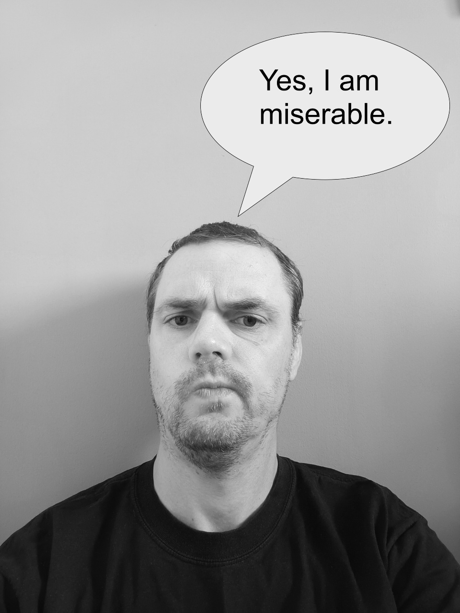

## About Me

Andy Marron is a sci-fi, urban fantasy and comedy author writing stories that put people or creatures in ridiculous situations. He works loosely on the premise "What if this thing was put in this situation?" Based on a concept made famous by Stephen King.

His love of comedy was born through decades of British TV sitcoms such as Red Dwarf, Blackadder and The Thick of It. His love of reading largely comes from books such as The HitchHikers Guide To The Galaxy and Rivers of London series. Other books he loves are the Abhorsen series, His Dark Materials, the Dungeon Crawler Carl series and anything by Terry Pratchett. He also enjoys reading sport and music biographies.

He began writing when he hit a period of depression in his mid 40's. One day he opened Microsoft Word and the words started tumbling out. He detailed his entire journey of being in an unsigned band into his first manuscript with one of his chapters available on this site.

When he finished the book, he had the writing bug. He needed more. So far he has over twenty different book ideas that will become published works in the coming years.

<h2 style="clear: both; margin: 0; padding: 0.25rem 0;">How to contact me</h2>

Please sign up for my newsletter and mailing list and get a free short story (The Hockenspier Chronicles - Count Vladisivic) as a reward. It's about a vampire going through a mid-life crisis at the age of 537 and seeking professional help.

I read every message and email, so please drop me a line for a chat, or any queries.

email - 

Social media

* [Follow Andy Marron on TikTok](https://www.tiktok.com/@andy.marron)
* [Follow Andy Marron on Instagram](https://www.instagram.com/andy_marron_author)

### A Little More About Me

Born amongst the smog in Teesside, England, Andrew spent most of his childhood playing football and computer games. At five, his dad introduced him to the guitar, and he pretty much sucked at it from the beginning, eventually putting it away as he became a teenager. Later, he discovered rock and heavy metal, which inspired him to pick up the guitar again and (attempt to) play his favourite tunes. Since 1998, he has written numerous songs, played in various bands, and released music on streaming services, YouTube, and other platforms that people ignore.

In 2025, Andrew decided to put his stories and feelings about the unsigned music scene in a book. He called it "How To Not Make It in Music" since...well...he's never made it in music.

Despite not being a famous rockstar, he still writes and records music aswell as writing books.

He also enjoys making his own beer and wine and has been doing so for over 15+ years.

He still lives in Teesside with his family and has a day job that pays the bills.

© 2026 Andrew Marron