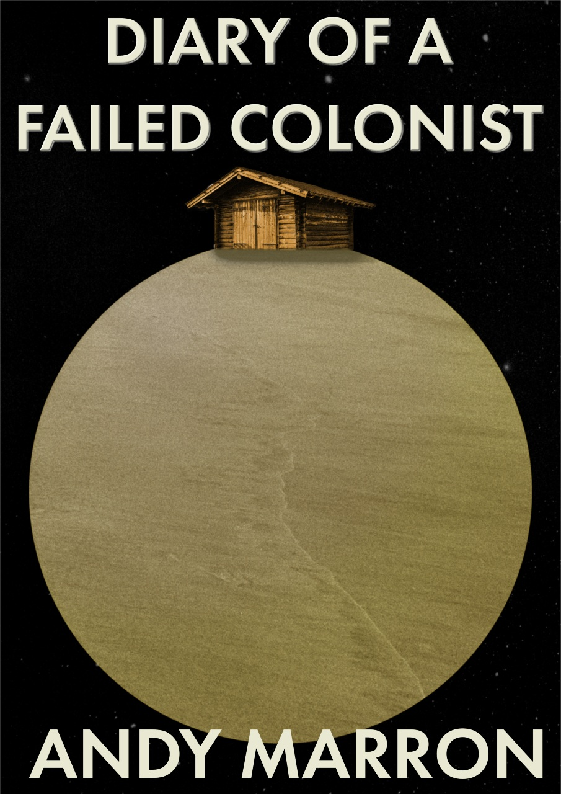

## Books

<h3 style="margin-top: 0;">The Hockenspier Chronicles – Count Vladisivic </h3>

<em>Free Reader Magnet · Urban Fantasy Comedy</em>

At 537 years old, Count Vladisivic  has survived centuries of undead drama only to hit a full-blown mid-life crisis. One day he discovers a grey hair and his world dissolves around him. So, after suffering a full-blown panic attack he does the only sensible thing left: he books an appointment seeking professional help.

<a href="/contact/" style="display: inline-block; padding: 0.6rem 1.2rem; background: #fff; color: #111; font-weight: 700; text-decoration: none; border-radius: 6px;">Get Your Free Copy →</a>

<h3 style="margin-top: 0;">Diary of a Failed Colonist</h3>

<em>Coming 2027 · Sci-Fi Comedy</em>

When Ed Thompson crash lands on Planet 47-B, he has one job: Make this the new Earth.

With an inventory that rivals most budget supermarkets, Ed certainly has his work cut out, but he has no doubt he's the best man for the job.

What Ed doesn't know is that he's being watched. And judged. Every action is being critiqued by the harshest critic he could imagine.

Will Ed succeed in his mission to tame the beige landscape and call it "Home", or will he die from an over-indulgence of tinned spaghetti hoops?

<a href="/contact/">Join the newsletter for release updates →</a>

© 2026 Andrew Marron